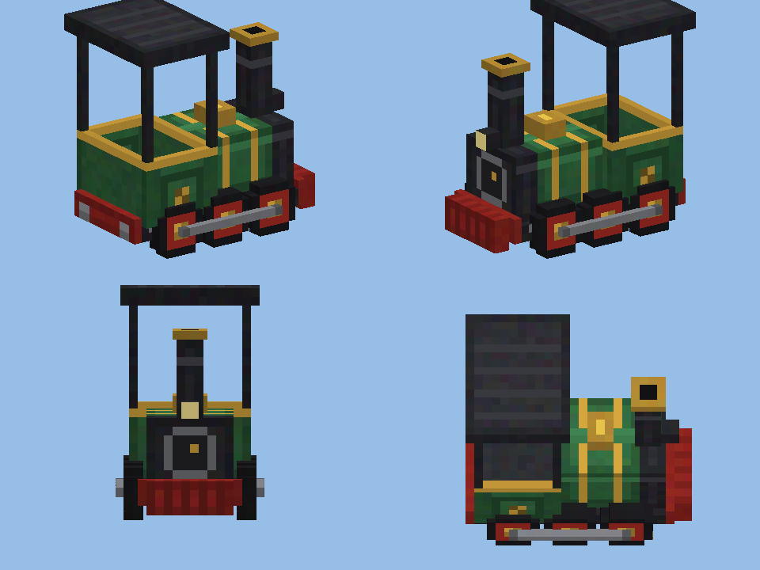

# 🚂 Locomotora de Vapor — mod para NeoForge 1.21.1

Agrega una **locomotora de vapor** que anda sobre los rieles normales de Minecraft. Se carga con carbón, tiene marchas (incluida marcha atrás), silbato, humo por la chimenea, ruedas y bielas animadas, y empuja las vagonetas que tenga adelante.



## Cómo se usa

| Acción | Qué hace |
|---|---|
| Clic derecho **sobre un riel** con el ítem | Coloca la locomotora mirando hacia donde miras |
| Clic derecho con **carbón / carbón vegetal** | Carga 1 pieza en la caldera (un **bloque de carbón** carga 9) |
| Clic derecho con la **mano vacía** | Te subes a la cabina como maquinista |
| **Shift + clic derecho** | Arranca (alejándose de ti) o frena, sin subirte |
| Montado: **W** / **S** | Sube / baja la marcha: atrás ◀, freno ■, 1, 2, 3 |
| Montado: **A** o **D** | Suena el silbato 🎵 |
| Montado: **Shift** | Te bajas |

- **Marcha 1**: lenta · **Marcha 2**: media · **Marcha 3**: a toda máquina (8 bloques por segundo, el máximo de los rieles).
- Gasta más carbón cuanto más rápido va. Con una pieza de carbón anda 4 minutos en marcha 1.
- La caldera guarda hasta 40 piezas. Si rompes la locomotora te devuelve el carbón que quedaba.
- Si choca contra algo y queda trabada, se frena sola.
- Un riel propulsor **apagado** la detiene (sirve como estación).
- Empuja a las vagonetas normales que tenga delante, como la vagoneta con horno.

## Receta

```
  [ ]   [Barrotes de hierro]   [ ]
[Lingote de hierro] [Horno] [Lingote de hierro]
  [ ]   [   Vagoneta   ]   [ ]
```

También está en el modo creativo, en la pestaña **Herramientas y utilidades**.

## Compilar el mod en GitHub (sin instalar nada)

1. Entra a <https://github.com/new>, pon un nombre (por ejemplo `locomotora-mod`) y toca **Create repository**.
2. En la página del repositorio vacío, toca el enlace **uploading an existing file**.
3. Descomprime el `.zip` y **arrastra todo lo que hay adentro** (las carpetas `.github`, `gradle`, `src`, `docs` y los archivos sueltos) a la página. Es importante que vaya la carpeta **`.github`**: en Mac aprieta `Cmd + Shift + .` en el Finder para ver las carpetas ocultas.
4. Abajo toca **Commit changes**.
5. Ve a la pestaña **Actions**. Vas a ver "Compilar mod" corriendo (tarda unos 3–5 minutos la primera vez).
6. Cuando tenga el tilde verde ✅, entra a esa ejecución y abajo, en **Artifacts**, descarga **locomotora-mod**. Es un `.zip` que adentro tiene `locomotora-1.0.0.jar`.

Si sale una cruz roja ❌, entra a la ejecución, abre el paso que falló y copia el error para arreglarlo.

## Instalar en Minecraft

1. Instala **NeoForge para 1.21.1** desde <https://neoforged.net>.
2. Copia `locomotora-1.0.0.jar` a la carpeta `mods` de tu `.minecraft`.
3. Abre el juego con el perfil de NeoForge.

## Compilar en tu computadora (opcional)

Con Java 21 instalado:

```
./gradlew build          (Linux / Mac)
gradlew.bat build        (Windows)
```

El `.jar` queda en `build/libs/`. Para probarlo directamente: `./gradlew runClient`.

## Estructura del código

```
src/main/java/com/locomotora/
├── LocomotoraMod.java            clase principal, registros y pestaña creativa
├── entidad/LocomotoraEntity.java la locomotora: motor, marchas, carbón, controles, humo
├── item/LocomotoraItem.java      el ítem que la coloca sobre los rieles
├── cliente/LocomotoraModelo.java el modelo 3D (cubos)
├── cliente/LocomotoraRenderer.java dibuja el modelo y anima ruedas y bielas
├── cliente/LocomotoraCliente.java registra el modelo y el renderer
└── registro/                     ítems, entidades y sonidos
```

Los valores fáciles de cambiar (velocidades, consumo de carbón, capacidad de la caldera) están al principio de `LocomotoraEntity.java`.
