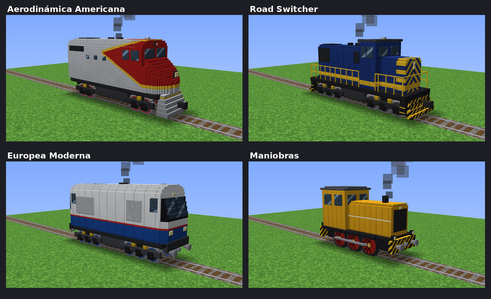

# 🚂 Locomotoras de Vapor y Diésel — mod para NeoForge 1.21.1

Siete locomotoras de **hasta 3 bloques de alto** que andan sobre los rieles normales de Minecraft: tres de vapor y cuatro diésel. Tienen marchas (incluida marcha atrás), silbato o bocina, humo, ruedas animadas, y empujan las vagonetas que tengan adelante.

## Vapor (usan carbón)


| Locomotora | Estilo | Velocidad máxima | Silbato |
|---|---|---|---|
| **Clásica del Oeste** | 4-4-0 americana: chimenea de embudo, farol grande, campana, cabina de madera | 7,2 bloques/s | normal |
| **Expreso Europeo** | Expreso británico verde con bronce, chimenea con copa de cobre, topes | 8 bloques/s | agudo |
| **Gigante de Carga** | Carguera alemana negra y roja, 8 ruedas motrices, deflectores de humo | 6,4 bloques/s, arranque lento | grave |

Más imágenes: [Clásica](docs/vapor_1.png) · [Expreso](docs/vapor_2.png) · [Gigante](docs/vapor_3.png)

## Diésel (usan bidón de diésel)



| Locomotora | Estilo | Velocidad máxima | Bocina |
|---|---|---|---|
| **Aerodinámica Americana** | Estilo F7: nariz de bulldog, roja y plateada con filete amarillo | 8 bloques/s | 5 tonos |
| **Road Switcher** | Capó largo azul y amarillo, barandas, quitanieves, bogies de 6 ruedas | 6,8 bloques/s | grave |
| **Europea Moderna** | Blanca y azul, cabina en los dos extremos, parabrisas inclinado, topes | 8 bloques/s, arranque rápido | aguda |
| **Maniobras** | Amarilla con rayas de seguridad, ruedas rojas con bielas | 4,8 bloques/s, muy ágil | aguda |

Más imágenes: [Americana](docs/diesel_1.png) · [Road Switcher](docs/diesel_2.png) · [Europea](docs/diesel_3.png) · [Maniobras](docs/diesel_4.png)

Las diésel tienen ruido de motor que acelera con la marcha, humo oscuro por el escape y la cabina adelante (las de vapor la tienen atrás).

## Cómo se usan

| Acción | Qué hace |
|---|---|
| Clic derecho **sobre un riel** con el ítem | Coloca la locomotora mirando hacia donde miras |
| Clic derecho con **carbón / carbón vegetal** (vapor) | Carga 1 pieza en la caldera (un **bloque de carbón** carga 9) |
| Clic derecho con un **bidón de diésel** (diésel) | Carga el tanque (un bidón rinde como 6 carbones) |
| Clic derecho con la **mano vacía** | Te subes a la cabina como maquinista |
| **Shift + clic derecho** | Arranca (alejándose de ti) o frena, sin subirte |
| Montado: **W** / **S** | Sube / baja la marcha: atrás ◀, freno ■, 1, 2, 3 |
| Montado: **A** o **D** | Suena el silbato o la bocina 🎵 |
| Montado: **Shift** | Te bajas |

- Gastan más combustible cuanto más rápido van. Con una pieza de carbón andan 4 minutos en marcha 1.
- La caldera o el tanque guarda hasta 40 carbones (casi 7 bidones). Si rompes la locomotora te devuelve lo que quedaba.
- Si choca contra algo y queda trabada, se frena sola.
- Un riel propulsor **apagado** la detiene (sirve como estación).
- Empuja a las vagonetas que tenga delante (o detrás, en marcha atrás) sin que se metan dentro del modelo.
- Necesita **2 bloques libres de alto** sobre la vía para pasar (aunque se vea de 3, el techo de los túneles puede atravesarla).
- Miden entre 5 y 7 bloques de largo: en las curvas cerradas sobresalen un poco hacia los costados.

## Recetas

**Vapor** — horno en el centro:

```
        [Barrotes de hierro]
[Lingote de hierro] [Horno] [Lingote de hierro]
   [ X ]       [Vagoneta]       [ X ]
```
Clásica: X = tablones · Expreso: X = tinte verde · Gigante: X = bloque de hierro

**Diésel** — pistón en el centro:

```
        [Barrotes de hierro]
[Lingote de hierro] [Pistón] [Lingote de hierro]
   [ X ]       [Vagoneta]       [ X ]
```
Americana: X = tinte rojo · Road Switcher: X = tinte azul · Europea: X = tinte blanco · Maniobras: X = tinte amarillo

**Bidón de diésel** (sin forma): 1 lingote de hierro + 2 carbones (o carbón vegetal) + 1 alga seca.

Todo está también en el modo creativo, en la pestaña **Herramientas y utilidades**.

## Compilar el mod en GitHub (sin instalar nada)

1. Entra a <https://github.com/new>, pon un nombre (por ejemplo `locomotora-mod`) y toca **Create repository**.
2. En la página del repositorio vacío, toca el enlace **uploading an existing file**.
3. Descomprime el `.zip` y **arrastra todo lo que hay adentro** (las carpetas `.github`, `gradle`, `src`, `docs` y los archivos sueltos) a la página. Es importante que vaya la carpeta **`.github`**: en Mac aprieta `Cmd + Shift + .` en el Finder para ver las carpetas ocultas.
4. Abajo toca **Commit changes**.
5. Ve a la pestaña **Actions**. Vas a ver "Compilar mod" corriendo (tarda unos 3–5 minutos la primera vez).
6. Cuando tenga el tilde verde ✅, entra a esa ejecución y abajo, en **Artifacts**, descarga **locomotora-mod**. Es un `.zip` que adentro tiene `locomotora-3.0.0.jar`.

Si ya tenías el repositorio de la versión anterior, sube los archivos nuevos encima (reemplazando los viejos) y borra `src/main/java/com/locomotora/cliente/LocomotoraModelo.java` si todavía está.

Si sale una cruz roja ❌, entra a la ejecución, abre el paso que falló y copia el error para arreglarlo.

## Instalar en Minecraft

1. Instala **NeoForge para 1.21.1** desde <https://neoforged.net>.
2. Copia `locomotora-3.0.0.jar` a la carpeta `mods` de tu `.minecraft` (borra la versión vieja si la tenías).
3. Abre el juego con el perfil de NeoForge.

## Compilar en tu computadora (opcional)

Con Java 21 instalado:

```
./gradlew build          (Linux / Mac)
gradlew.bat build        (Windows)
```

El `.jar` queda en `build/libs/`. Para probarlo directamente: `./gradlew runClient`.

## Estructura del código

```
src/main/java/com/locomotora/
├── LocomotoraMod.java                 clase principal y pestaña creativa
├── entidad/LocomotoraEntity.java      la locomotora: motor, marchas, combustible, controles, humo, sonidos
├── entidad/TipoLocomotora.java        medidas, velocidades y tipo (vapor o diésel) de cada modelo
├── item/LocomotoraItem.java           el ítem que la coloca sobre los rieles
├── cliente/LocomotoraRenderer.java    dibuja el modelo y anima ruedas y bielas
├── cliente/LocomotoraCliente.java     registra los modelos y renderers
├── cliente/modelos/Modelo*.java       los modelos 3D (generados desde el estudio de diseño)
└── registro/                          ítems (incluido el bidón), entidades y sonidos
```

Las velocidades, la aceleración y el tono del silbato o bocina de cada locomotora están en `TipoLocomotora.java`; el consumo, la capacidad y lo que rinde un bidón, al principio de `LocomotoraEntity.java`.
