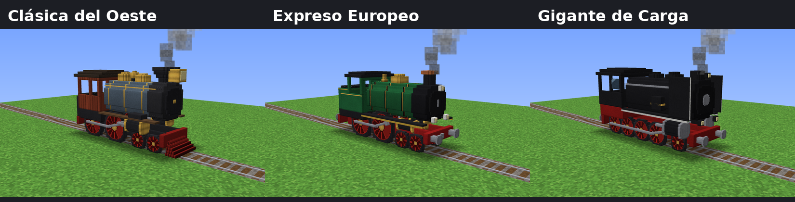

# 🚂 Locomotoras de Vapor — mod para NeoForge 1.21.1

Tres locomotoras de vapor de **hasta 3 bloques de alto** que andan sobre los rieles normales de Minecraft. Se cargan con carbón, tienen marchas (incluida marcha atrás), silbato, humo por la chimenea, ruedas y bielas animadas, y empujan las vagonetas que tengan adelante.



| Locomotora | Estilo | Velocidad máxima | Silbato |
|---|---|---|---|
| **Clásica del Oeste** | 4-4-0 americana: chimenea de embudo, farol grande, campana, cabina de madera | 7,2 bloques/s | normal |
| **Expreso Europeo** | Expreso británico verde con bronce, chimenea con copa de cobre, topes | 8 bloques/s (la más rápida) | agudo |
| **Gigante de Carga** | Carguera alemana negra y roja, 8 ruedas motrices, deflectores de humo | 6,4 bloques/s, arranque lento | grave |

Más imágenes: [Clásica](docs/diseno_1.png) · [Expreso](docs/diseno_2.png) · [Gigante](docs/diseno_3.png)

## Cómo se usan

| Acción | Qué hace |
|---|---|
| Clic derecho **sobre un riel** con el ítem | Coloca la locomotora mirando hacia donde miras |
| Clic derecho con **carbón / carbón vegetal** | Carga 1 pieza en la caldera (un **bloque de carbón** carga 9) |
| Clic derecho con la **mano vacía** | Te subes a la cabina como maquinista |
| **Shift + clic derecho** | Arranca (alejándose de ti) o frena, sin subirte |
| Montado: **W** / **S** | Sube / baja la marcha: atrás ◀, freno ■, 1, 2, 3 |
| Montado: **A** o **D** | Suena el silbato 🎵 |
| Montado: **Shift** | Te bajas |

- Gasta más carbón cuanto más rápido va. Con una pieza de carbón anda 4 minutos en marcha 1.
- La caldera guarda hasta 40 piezas. Si rompes la locomotora te devuelve el carbón que quedaba.
- Si choca contra algo y queda trabada, se frena sola.
- Un riel propulsor **apagado** la detiene (sirve como estación).
- Empuja a las vagonetas que tenga delante (o detrás, en marcha atrás) sin que se metan dentro del modelo.
- Necesita **2 bloques libres de alto** sobre la vía para pasar (aunque se vea de 3, el techo de los túneles puede atravesarla).
- Miden unos 5,5 bloques de largo: en las curvas cerradas sobresalen un poco hacia los costados.

## Recetas

Las tres comparten la base y cambia la fila de abajo:

```
        [Barrotes de hierro]
[Lingote de hierro] [Horno] [Lingote de hierro]
   [ X ]       [Vagoneta]       [ X ]
```

- **Clásica del Oeste**: X = tablones (de cualquier madera)
- **Expreso Europeo**: X = tinte verde
- **Gigante de Carga**: X = bloque de hierro

También están en el modo creativo, en la pestaña **Herramientas y utilidades**.

## Compilar el mod en GitHub (sin instalar nada)

1. Entra a <https://github.com/new>, pon un nombre (por ejemplo `locomotora-mod`) y toca **Create repository**.
2. En la página del repositorio vacío, toca el enlace **uploading an existing file**.
3. Descomprime el `.zip` y **arrastra todo lo que hay adentro** (las carpetas `.github`, `gradle`, `src`, `docs` y los archivos sueltos) a la página. Es importante que vaya la carpeta **`.github`**: en Mac aprieta `Cmd + Shift + .` en el Finder para ver las carpetas ocultas.
4. Abajo toca **Commit changes**.
5. Ve a la pestaña **Actions**. Vas a ver "Compilar mod" corriendo (tarda unos 3–5 minutos la primera vez).
6. Cuando tenga el tilde verde ✅, entra a esa ejecución y abajo, en **Artifacts**, descarga **locomotora-mod**. Es un `.zip` que adentro tiene `locomotora-2.0.0.jar`.

Si sale una cruz roja ❌, entra a la ejecución, abre el paso que falló y copia el error para arreglarlo.

## Instalar en Minecraft

1. Instala **NeoForge para 1.21.1** desde <https://neoforged.net>.
2. Copia `locomotora-2.0.0.jar` a la carpeta `mods` de tu `.minecraft`.
3. Abre el juego con el perfil de NeoForge.

## Compilar en tu computadora (opcional)

Con Java 21 instalado:

```
./gradlew build          (Linux / Mac)
gradlew.bat build        (Windows)
```

El `.jar` queda en `build/libs/`. Para probarlo directamente: `./gradlew runClient`.

## Estructura del código

```
src/main/java/com/locomotora/
├── LocomotoraMod.java                 clase principal y pestaña creativa
├── entidad/LocomotoraEntity.java      la locomotora: motor, marchas, carbón, controles, humo
├── entidad/TipoLocomotora.java        medidas y velocidades de cada modelo
├── item/LocomotoraItem.java           el ítem que la coloca sobre los rieles
├── cliente/LocomotoraRenderer.java    dibuja el modelo y anima ruedas y bielas
├── cliente/LocomotoraCliente.java     registra los modelos y renderers
├── cliente/modelos/Modelo*.java       los modelos 3D (generados desde el estudio de diseño)
└── registro/                          ítems, entidades y sonidos
```

Las velocidades, la aceleración y el tono del silbato de cada locomotora están en `TipoLocomotora.java`; el consumo de carbón y la capacidad de la caldera, al principio de `LocomotoraEntity.java`.
